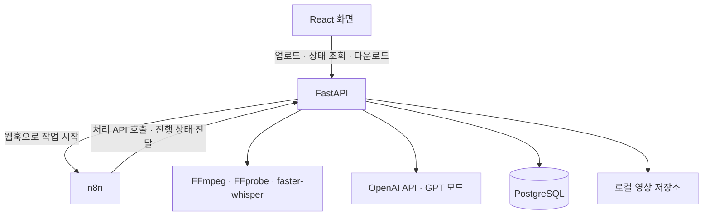

# 🎬 ShortsFlow AI

> MP4 한 편을 올리면, 자막이 들어간 쇼츠 한 편으로.

원본 영상에서 음성을 추출하고 자막을 생성해, 쇼츠로 만들 구간을 선택하고 편집하는 **숏폼 영상 자동화 프로젝트**입니다. <br>
React에서 MP4를 업로드하면 n8n이 FastAPI의 영상 처리 API를 순서대로 호출합니다.

**영상별 작업 추적 · 자막 구간 기반 편집 · 업로드부터 결과 다운로드까지 자동화**를 중심으로 구현했습니다. <br>
영상 변환과 음성 전사는 로컬에서 실행하며, 구간 분석은 Mock과 GPT 모드를 지원합니다.

[프론트엔드 코드](frontend/src) · [백엔드 코드](backend/app) · [n8n 워크플로우](n8n/shortsflow-workflow.json) · [테스트 코드](backend/tests)

[핵심 기능](#-핵심-기능) · [서비스 구조](#-서비스-구조) · [주요 설계](#-주요-설계) · [코드 점검과 테스트](#-코드-점검과-테스트) · [기술 스택](#-기술-스택) · [로컬 실행](#-로컬-실행)

<br>

## 📌 핵심 기능

- **자동 편집** — MP4 업로드 한 번으로 음성 추출부터 자막이 합성된 쇼츠 생성까지 실행
- **진행 상태 확인** — 음성 추출·전사·분석·렌더링 단계와 완료·후보 없음·실패 결과 표시
- **결과 조회** — 영상 UUID로 기존 작업을 다시 열고 생성된 결과물 다운로드

| 기능 | 구현 내용 |
| --- | --- |
| 영상 업로드 | 최대 100 MiB MP4 업로드, FFprobe로 길이·해상도·코덱·오디오 유무 확인 |
| 음성·프레임 추출 | 16kHz 모노 WAV 추출, 지정한 시점의 JPG 프레임 추출 |
| 자막 생성 | faster-whisper로 음성을 전사하고 원본 영상 기준 시작·종료 시각과 대사를 JSON으로 저장 |
| 쇼츠 구간 분석 | Mock 또는 GPT로 연속 자막 구간을 분석해 후보 최대 1개와 제목·썸네일 문구 선정 |
| 쇼츠·썸네일 생성 | 선택 구간의 원본 음성과 자막을 포함한 MP4 및 썸네일 JPG 생성 |
| 결과물 다운로드 | 원본 MP4·WAV·프레임·자막 JSON·쇼츠 MP4·썸네일 JPG 다운로드 |

<br>

## 📌 서비스 구조

React는 파일 업로드, 작업 상태 표시, 다운로드를 담당합니다. <br>
FastAPI는 영상 처리와 데이터 저장을 맡고, n8n은 웹훅을 받은 뒤 처리 API를 순서대로 호출하고 각 단계의 결과를 FastAPI에 전달합니다.



| 경로 | 역할 |
| --- | --- |
| `frontend/src/App.tsx` | 영상 업로드·조회, 자동 편집 진행 팝업, 결과 다운로드 |
| `backend/app/routes/` | 영상 처리·워크플로우·상태 점검 API |
| `backend/app/schemas/` | 영상·자막·분석·워크플로우 요청 및 응답 모델 |
| `backend/app/services/` | 미디어 처리, 콘텐츠 분석, 작업 상태 관리, DB 저장 |
| `backend/sql/` | 분석 및 워크플로우 테이블 마이그레이션 |
| `backend/tests/` | 콘텐츠 분석 및 쇼츠 자막 관련 테스트 |
| `n8n/shortsflow-workflow.json` | 웹훅, 영상 처리 단계, 분석 폴링 및 결과 전달 정의 |

<br>

## 📌 주요 설계

### 1. 영상 UUID를 기준으로 작업과 결과물 관리

업로드 시 발급한 `video_id`로 영상 조회, 추출, 분석, 자동 편집을 연결합니다. <br> 쇼츠와 썸네일은 `analysis_id`까지 함께 사용해 해당 분석에서 생성한 파일을 조회합니다.

| 저장 위치 | 저장 내용 |
| --- | --- |
| PostgreSQL | 영상 메타데이터, 추출 결과 경로, 분석 후보와 상태, 워크플로우 진행 단계 |
| 로컬 영상 저장소 | 원본 MP4, WAV, JPG, 자막 JSON, 렌더링 결과물 |

영상 파일은 기본적으로 `backend/storage/videos/<video_id>/` 아래에 저장합니다. <br> 기존 `metadata.json` 작업도 같은 UUID로 조회·다운로드할 수 있습니다.

[영상 처리 서비스](backend/app/services/videos.py) · [DB 저장 로직](backend/app/services/video_records.py)

<br>

### 2. 자막 구간을 기준으로 쇼츠 편집

Whisper의 전사 시각에 영상과 음성 트랙의 시작 시각 차이를 반영합니다. <br>
GPT 모드에서는 모델이 고른 시작·종료 자막 ID를 서버가 실제 타임스탬프로 변환합니다. 서버는 선택한 구간의 순서, 영상 범위, 길이를 검증합니다.

| 분석 모드 | 처리 방식 |
| --- | --- |
| Mock | 예제 영상의 연속 자막 구간과 일치할 때 고정 후보 반환 |
| GPT | 저장된 자막을 OpenAI Responses API로 분석해 구간 ID와 쇼츠 문구 반환 |

일반 영상의 후보 길이는 15~30초이며, 원본이 30초보다 짧으면 원본 범위 안에서 더 짧은 구간도 허용합니다. <br> 렌더링 시 선택 구간과 겹치는 자막만 클립 시작 기준으로 변환해 영상에 합성합니다.

[자막 생성](backend/app/services/transcripts.py) · [구간 분석](backend/app/services/content_analysis.py) · [쇼츠 렌더링](backend/app/services/shorts.py)

<br>

### 3. n8n으로 처리 순서를 연결하고 진행 상태를 저장

FastAPI는 영상마다 워크플로우 상태를 한 건 저장합니다. 같은 영상 UUID로 시작 요청이 반복되면 기존 작업을 반환합니다. <br> 진행 상태를 바꾸는 n8n 콜백은 작업별 토큰과 허용된 단계 전이를 검사합니다.

| 상황 | 처리 방식 |
| --- | --- |
| MP4 업로드 완료 | React가 영상 UUID로 자동 편집 시작 요청 |
| 분석 대기·실행 중 | n8n이 동일한 분석 ID를 2초 간격으로 조회 |
| 후보 선정 완료 | 쇼츠·썸네일 생성 후 분석 ID와 완료 상태 저장 |
| 후보 없음·처리 실패 | 종료 상태와 원인을 저장하고 진행 팝업에 표시 |
| 결과 다운로드 | React가 완료된 작업의 분석 ID로 쇼츠 MP4 요청 |

[워크플로우 서비스](backend/app/services/workflows.py) · [n8n 워크플로우](n8n/shortsflow-workflow.json)

<br>

## 📌 코드 점검과 테스트

프론트엔드와 백엔드 명령은 각각 해당 디렉터리에서 실행합니다.

```powershell
# frontend
npm.cmd run lint
npm.cmd run build

# backend
.\.venv\Scripts\python.exe -m unittest discover -s tests -v
```

| 항목 | 확인 범위 |
| --- | --- |
| 프론트엔드 | Oxlint 검사, TypeScript 타입 검사, Vite 빌드 |
| 콘텐츠 분석 | OpenAI 응답을 모의하고 FastAPI 요청과 PostgreSQL 저장·조회를 검증 |
| 쇼츠 자막 | 클립 기준 자막 시각 변환, 표시 범위와 겹침 처리 검증 |
| 자동 편집 | 테스트 MP4를 업로드해 진행 팝업, 편집 완료, MP4 다운로드 확인 |

콘텐츠 분석 통합 테스트에는 영상 기본 테이블과 분석 마이그레이션이 적용된 로컬 테스트 DB가 필요합니다.

<details>
<summary>Mock 영상으로 자동 편집 확인</summary>

1. `ANALYSIS_MOCK_MODE=true`로 설정합니다.
2. 백엔드를 시작할 PowerShell에서 `$env:WHISPER_MODEL = 'medium'`을 지정합니다.
3. [PR #5](https://github.com/WONDongin/shortsflow-ai/pull/5)에서 사용한 원본 MP4를 업로드합니다. 기존 작업 폴더에 원본이 있으면 `source.mp4`를 선택합니다.
4. 편집이 끝나면 **편집 영상 다운로드**를 클릭하고 원본 음성과 합성 자막을 확인합니다. 예상 길이는 약 19.5초입니다.

Mock은 예제 영상의 대사와 두 연속 구간의 타임스탬프가 일치할 때 후보를 반환합니다. 기본 `small` 모델이나 다른 영상에서는 `no_candidate`가 나올 수 있습니다.

```powershell
ffprobe -v error -show_entries 'format=duration:stream=codec_type,codec_name' -of json .\shorts.mp4
```

</details>

<br>

## 📌 기술 스택

| 구분 | 기술 |
| --- | --- |
| 웹 UI | React · TypeScript · Vite · Gmarket Sans |
| 백엔드 | Python · FastAPI · Uvicorn · Pydantic |
| 데이터 저장 | PostgreSQL · SQLAlchemy · psycopg · 로컬 파일 저장소 |
| 영상 처리 | FFmpeg · FFprobe |
| 음성 전사·구간 분석 | faster-whisper · OpenAI Responses API · Mock |
| 워크플로우 | n8n 2.x · Webhook · REST API |
| 코드 점검·테스트 | Oxlint · TypeScript · unittest · FastAPI TestClient |

<br>

## 📌 로컬 실행

Windows PowerShell 기준으로 Python 3.12, Node.js 22.17.1, PostgreSQL, FFmpeg·FFprobe를 준비합니다. <br>
FFmpeg는 `libx264` 인코더와 `drawtext` 필터를 지원해야 합니다.

```powershell
git clone https://github.com/WONDongin/shortsflow-ai.git
Set-Location shortsflow-ai
```
<br>

### 1. 백엔드와 PostgreSQL 준비

아래 명령은 저장소 루트에서 시작합니다. `py` 런처를 사용할 수 없으면 설치한 Python 3.12의 `python.exe` 경로로 가상환경을 만듭니다.

```powershell
Set-Location backend
py -3.12 -m venv .venv
.\.venv\Scripts\python.exe -m pip install -r requirements.txt
Copy-Item .env.example .env
```

[환경변수 예시](backend/.env.example)를 참고해 `.env`의 `DB_HOST`, `DB_PORT`, `DB_NAME`, `DB_USER`, `DB_PASSWORD`를 설정합니다. 기본 연결 대상은 `localhost:5432`의 `shortsflow` DB와 `shortsflow_user` 계정입니다.

현재 저장소의 SQL은 분석과 워크플로우 테이블을 생성합니다. 먼저 `shortsflow_app.videos`, `shortsflow_app.video_artifacts`가 준비된 PostgreSQL DB에 연결한 뒤 아래 마이그레이션을 적용합니다.

```powershell
@'
from pathlib import Path
from app.db import get_engine

with get_engine().begin() as connection:
    for path in ("sql/010_video_analyses.sql", "sql/011_video_workflows.sql"):
        connection.exec_driver_sql(Path(path).read_text(encoding="utf-8"))
'@ | .\.venv\Scripts\python.exe -

.\.venv\Scripts\python.exe -m uvicorn app.main:app --reload --host 127.0.0.1 --port 8000
```

| 확인 항목 | 주소 |
| --- | --- |
| FastAPI 상태 | [GET /api/health](http://127.0.0.1:8000/api/health) |
| DB 연결 및 기본 테이블 읽기 | [GET /api/health/db](http://127.0.0.1:8000/api/health/db) |
| 영상 처리 API 문서 | [Swagger UI](http://127.0.0.1:8000/docs) |

<br>

### 2. n8n 워크플로우 연결

별도 PowerShell에서 n8n을 시작합니다.

```powershell
$env:N8N_LISTEN_ADDRESS = '127.0.0.1'
$env:N8N_HOST = '127.0.0.1'
$env:N8N_PORT = '5678'
npx.cmd --yes n8n@2
```

1. [n8n 편집기](http://127.0.0.1:5678)에서 **Import from File**로 [shortsflow-workflow.json](n8n/shortsflow-workflow.json)을 가져옵니다.
2. **Publish**한 뒤 **ShortsFlow webhook** 노드의 Production URL을 확인합니다.
3. Production URL이 기본값 `http://127.0.0.1:5678/webhook/shortsflow`와 다르면 `backend/.env`의 `N8N_WEBHOOK_URL`을 수정합니다. <br>  FastAPI 주소를 바꿨다면 n8n의 **FastAPI URL** 노드도 수정하고 다시 게시합니다.

<br>

### 3. 프론트엔드 실행

새 PowerShell을 저장소 루트에서 열고 실행합니다.

```powershell
Set-Location frontend
npm.cmd ci
npm.cmd run dev
```

[ShortsFlow AI 화면](http://127.0.0.1:5173)에서 MP4를 선택하고 **업로드**를 누릅니다. 편집이 완료되면 팝업을 닫고 **편집 영상 다운로드**를 선택합니다.

<details>
<summary>추가 환경 설정</summary>

| 설정 | 용도 |
| --- | --- |
| `ANALYSIS_MOCK_MODE` | 기본값 `true`. 실제 GPT를 사용하려면 `false`로 변경 |
| `OPENAI_API_KEY` · `OPENAI_MODEL` | GPT 모드에서 백엔드에 지정. 기본 모델 `gpt-5.4-mini` |
| `WHISPER_MODEL` | 백엔드 실행 전 지정. 기본값 `small`, 로컬 모델 디렉터리도 지정 가능 |
| `FFMPEG_PATH` · `FFPROBE_PATH` | 시스템 PATH에서 실행 파일을 찾을 수 없을 때 지정 |
| `VIDEO_STORAGE_DIR` | 영상 저장 경로. 기본값 `backend/storage/videos` |
| `THUMBNAIL_FONT_PATH` | 자막·썸네일에 사용할 글꼴 파일 경로 |
| `VITE_API_BASE_URL` | React가 호출할 FastAPI 주소. 기본값 `http://127.0.0.1:8000` |
| `CORS_ORIGINS` | 백엔드가 허용할 프론트엔드 출처. 기본값은 `localhost:5173`과 `127.0.0.1:5173`의 HTTP 주소 |

Whisper 모델이 캐시에 없으면 첫 전사 요청에서 가중치를 내려받습니다. 이후 전사는 로컬에서 실행됩니다.

</details>
